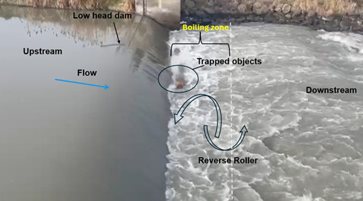
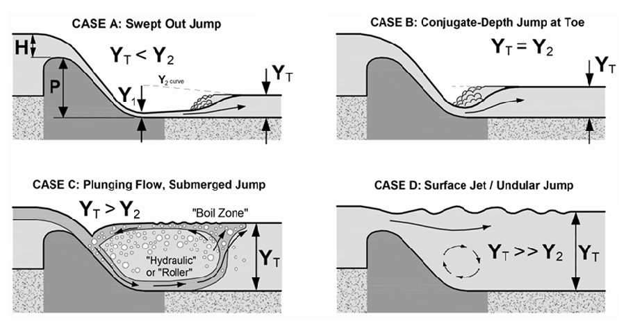
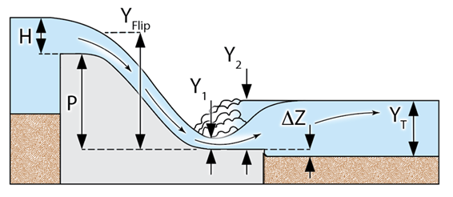

<h1> What is Low head dam and Reverse Roller? </h1>

There are thousands of low-head dams, generally defined as dams with heights less than or equal to 15 feet, across the United States. These structures were originally constructed for various purposes, including water supply, navigation, recreation, power generation, and irrigation. Many low-head dams also serve as popular recreational sites.

However, the flow conditions immediately downstream of these dams can become highly transient and exhibit complex three-dimensional behavior, especially during high-flow seasons. These conditions can be extremely hazardous for recreational users, including swimmers, boaters, kayakers, anglers, and other river users.

During such conditions, a hydraulic jump often forms downstream of the dam. This jump can become submerged when the tailwater depth exceeds the sequent depth of the jump. This phenomenon, commonly referred to as a submerged hydraulic jump or reverse roller, is characterized by significant air entrainment caused by the impinging nappe.

The resulting flow region can have significantly reduced buoyancy, making it extremely hazardous. Floating objects, including human bodies, can become trapped in the recirculating currents and may be unable to escape without external assistance. Numerous incidents involving swimmers, boaters, kayakers, and anglers have been reported in submerged rollers downstream of low-head dams(Fig-1).

<figure>
  
  <figcaption>
    <strong>Figure 1.</strong> Formation of a submerged jump/reverse roller near the toe of a low-head dam.
  </figcaption>
</figure>

Understanding the flow conditions under which a reverse roller forms, and how the flow transitions from a free jump to a partially submerged or fully submerged hydraulic jump, is essential for hazard assessment and mitigation.

<figure>
  
  <figcaption>
    <strong>Figure 2.</strong> All four stages of flow downstream of low head dams (Tschantz and Wright, (2010)).
  </figcaption>
</figure>

<figure>
  
  <figcaption>
    <strong>Figure 3.</strong> Parameters of hydraulic jump for prediction of submerged jump or reverse roller downstream of low head dam (Caleb et al., 2024)
  </figcaption>
</figure>

There are specific ranges of tailwater depth that can lead to the formation of a reverse roller or submerged hydraulic jump. The range between the conjugate depth, <em>y2</em>, and the flip depth, <em>yflip</em>, is particularly hazardous:

<em>yflip &gt; yt &gt; y2</em>

Within this range, the tailwater depth can create a strong reverse roller capable of trapping floating objects or recreational users. Although physical hydraulic modeling in laboratory settings can be used to study these phenomena, such experiments are often expensive, time-consuming, and difficult to scale to field conditions(Fig-2 & Fig-3).

