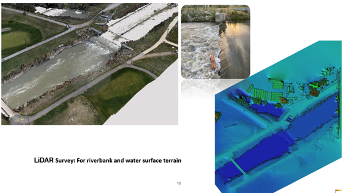

<h1> Obtaining field data </h1>

<h2>Geometry data </h2>

The first step is to prepare the hydraulic-structure geometry and verify that the model dimensions are suitable for FLOW-3D simulation.

<ul>

&#x20; <li>Obtain detailed weir/low head dam dimensions from as-built drawings, design blueprints, or site surveys.</li>

&#x20; <li>Identify key parameters such as crest shape, crest length, structure height, slopes, steps, piers, abutments, and venting systems.</li>

</ul>

<h2>Bathymetry and Terrain Preparation</h2>

Bathymetry and terrain data are required to represent the upstream and downstream channel geometry around the low-head dam.

<ul>

&#x20; <li>Conduct a bathymetric survey of the upstream and downstream channel to capture channel-bed topography and flow parameters such as discharge, velocity, and depth.</li>

&#x20; <li>Use ADCP for bathymetric survey and LiDAR for overall terrain representation(Fig-5).</li>

&#x20; <li>Use a high-resolution DEM for hydraulic simulation where detailed terrain representation is required.</li>

&#x20; <li>Survey channel banks and surrounding terrain to define computational boundaries and capture the natural topography of the channel.</li>

&#x20; <li>Take two cross sections immediately upstream and downstream of the low-head dam, and additional cross sections farther upstream and downstream as needed.</li>

&#x20; <li>Determine cross-section spacing based on channel-bank irregularity, bed variability, sudden bed changes, and the upstream/downstream boundary-condition requirements for CFD modeling.</li>

</ul>

<figure>
  
  <figcaption>
    <strong>Figure 5.</strong> LiDAR Survey for riverbank and water surface terrain at low head dam, Jordan river, Utah.
  </figcaption>
</figure>

If bathymetry, DEM, or cross-section data are included, the terrain should be prepared before creating the FLOW-3D model.

